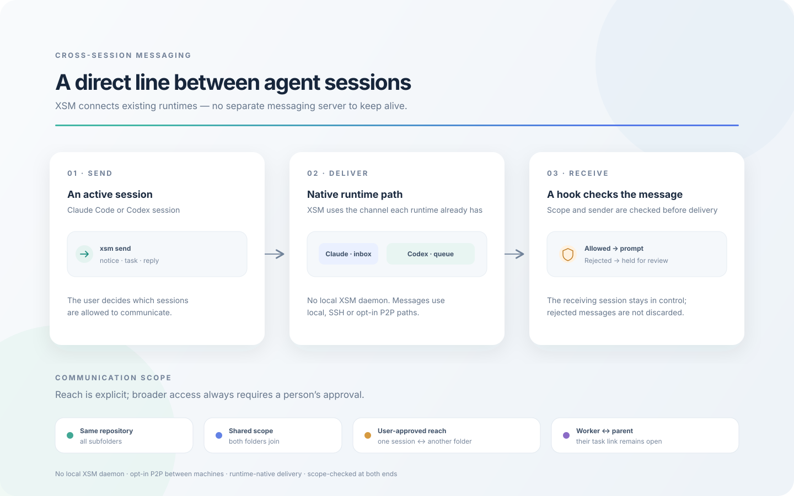

# xsm (Cross-Session Messaging)

English | [한국어](README_ko.md)

> **All you need is a message channel. The rest is done by agents.**

xsm lets the Claude Code and Codex sessions you already run find each other and work together: on one
machine, across config homes and runtimes, and across your machines. An agent finds a peer by what it is
working on, connects to the one you pick, asks it a question and gets the actual answer back, and can tell
you at each step what has and has not happened.



> **Release status.** Work discovery, `connect` and `ask`, attachments, owned workers and the opt-in P2P
> network arrived in 0.5.0; see the [changelog](CHANGELOG.md). Which environments each part was verified on is recorded in the
> [ADR-0021 closure record](docs/plan/collaboration/adr-0021-closure.md) and the
> [completion ledger](docs/plan/collaboration/completion-ledger.md); the plan as a whole is not complete.

## Philosophy

Multi-agent tools such as Orca, herdr and OpenRig make coordination their product: a dispatcher, a task
graph, a team defined in YAML, terminals the tool owns. xsm builds none of that. It gives the sessions you
already run a way to reach each other, and leaves the rest to them. Agents read and write plain language;
given a channel, they split the work, hand it off, review each other and report back, the way people do in a
chat channel. The better the models get, the less a fixed structure helps and the more it gets in the way.

What xsm does not have:

- no orchestrator, team spec or task graph: who does what is decided in the conversation
- no runtime of its own and no wrapper around `claude` or `codex`: you start your sessions as you always do
- no server between sessions on one machine: local messaging is hooks, files and one-shot commands. The only
  resident process is the opt-in P2P network service, which runs only after you create or join a network
  and stops with `xsm network stop`

Because everything else is left to the agents, the channel itself has to be dependable. That is where xsm puts
its effort:

- **A message wakes the session.** A message is a DM, addressed to the session the sender names. It goes in
  through each runtime's own path (the Claude inbox socket, `codex queue`), not by typing into a terminal, so an
  idle session picks it up, and the message arrives marked with its sender instead of looking like something
  you typed. A message that should not interrupt can wait for the session's next natural turn instead
  (`--wake never`).
- **The sender knows what happened.** Stored, handed to the runtime, acknowledged after reading, and actually
  answered are four separate facts, and each result says which ones hold. A lost response is recovered by its
  request ID, never resent under a new one, and a task counts as done only when the peer says so.
- **Finding is not permission.** A session is a candidate only if you published it or it is in the same
  repository. Picking one connects you with that conversation alone, not its folder or the other candidates.
- **People keep the boundaries.** Which sessions can talk is a scope you set. Widening it, publishing a
  session or joining a network takes your word, and a message from another agent never counts as your approval.

## TL;DR

Give this prompt to your coding agent (Claude Code or Codex), and it installs xsm on both runtimes and
checks the result:

```
Install xsm from https://github.com/ysys143/xsm on both Claude Code and Codex on this machine.
Then verify it with `xsm doctor` and `xsm selftest`, and tell me anything I still have to do myself,
such as trusting the hooks in Codex or starting a new session.
```

The agent follows this README for both runtimes and reports what it verified. Coding agents often cannot type
slash commands such as `/plugin`; they can use the direct install (`xsm install`) described under Quick start.

Once it is installed, open a new session on either side and talk to it:

```
How do I use this? Show me with a real demo.
Make this session discoverable through xsm.
Find the sessions working on the config change and show me the candidates.
Connect to a1 so we can work together, then ask it to review my diff.
```

The agent reads the skill's guide and runs `xsm` itself, so you do not have to learn the commands first.
To install by hand, read on.

## Quick start

### 1. Install manually

xsm runs on macOS and Linux. It needs Unix sockets, `ps`, `/dev/tty` and tmux, so native Windows is not
supported. Local messaging uses only the Python standard library. The optional P2P network also needs a Rust
toolchain once, to build its engine (see [Working with another machine](#5-working-with-another-machine)).
Installing means making each session run xsm's hooks.

**Claude Code plugin** (recommended). The repository is its own marketplace.

```
/plugin marketplace add ysys143/xsm
/plugin install xsm@xsm
```

The plugin bundles the hooks, the skill, the MCP server and `bin/`. It updates when `version` in
`plugin.json` goes up, and disabling it also disables the hooks.

**Codex plugin** (recommended). The same repository is also a Codex marketplace.

```bash
codex plugin marketplace add ysys143/xsm
codex plugin add xsm@xsm
```

The plugin bundles two hooks, the skill and the MCP server. Codex runs a plugin's hooks only after you trust
them: in the first session, choose "Trust all and continue" under `/hooks`.

<details>
<summary>More on the Codex plugin: PATH, updating, leftovers of an earlier install</summary>

- Codex does not put a plugin's `bin/` on PATH, so every session start links `~/.local/bin/xsm` to the
  plugin. An existing link or file there that does not point to an xsm plugin folder is left alone.
- To update, run `codex plugin marketplace upgrade xsm`, then `codex plugin add xsm@xsm` again.
- If this home was installed earlier with `xsm install --codex-home`, run `xsm install --refresh` once after
  adding the plugin. It removes the hook groups, MCP entry and skill link that install left behind, which
  would otherwise run alongside the plugin's.

</details>

<details>
<summary>Without a plugin: <code>xsm install</code></summary>

```bash
bin/xsm install --claude-home <my-claude-config-dir>          # install directly instead of the plugin
bin/xsm install --claude-home <dir-A> --claude-home <dir-B>   # several homes in one command
bin/xsm install --codex-home <my-codex-home>                  # Codex hooks, skill and MCP
bin/xsm install --refresh                                     # bring every installed home up to date
bin/xsm doctor                                                # install state, stale copies, what is blocked now
```

`--claude-home` takes Claude Code's config directory (`CLAUDE_CONFIG_DIR`) and `--codex-home` takes Codex's
(`CODEX_HOME`). Unless you changed them, these are `~/.claude` and `~/.codex`. There is no default home, so
except with `--refresh` you must name at least one. Repeat `--claude-home` to cover several homes.

A directly installed copy does not follow changes to the repository. When `xsm doctor` reports it as stale,
update it with `xsm install --refresh`. After a plugin update, run `install --refresh` with the new
version's `bin/xsm`.

What a direct install runs from: `xsm install` copies the runtime of this checkout (`xsm/`, `hooks/`,
`skills/`, `bin/`, the plugin manifests) to `~/.xsm/runtime/<id>/` and points everything at that copy: the
Claude hook command (the `hooks/xsm-hook` launcher, which finds a working python itself and turns a script it
cannot open into an error, never a blocked prompt), the MCP server registration (the `hooks/xsm-mcp`
launcher), and `~/.local/bin/xsm`. macOS can deny a session's app the folder a checkout lives in
(`~/Documents`), and a hook that cannot run must not stop a prompt. The copy before the current one stays
until no live session started before it, and is then pruned when the next `xsm install` finishes (not before:
the pruning reads the process table, which a hook has no time for). `xsm doctor`'s `runtime` line names the
copy and says when the checkout has moved on; the agent then runs `<checkout>/bin/xsm install --refresh`.
`--dev` (or `"runtime": "checkout"` in `config.json`) keeps everything pointing at the checkout, for
developing xsm; `--dev` saves that line itself, so a later `install --refresh` or `doctor` keeps it (delete
the line to go back to a copy). A Codex direct install keeps the hook command it has, because Codex's trust
covers its text; a new one names `~/.xsm/runtime/current`, which stays the same across refreshes. Only
`codex plugin add xsm@xsm` moves an existing Codex install off its checkout.

For each Claude home, install also sets `crossSessionInbound` to `"accept"` (Claude Code 2.1.224 and later;
a value the home already has stays), so Claude delivers a message from another of your sessions whatever the
two permission modes are. It allows the messaging commands in `permissions.allow`, by name and by the
runtime's absolute path: `connect`, `ask`, `question-status`, `decision-status`, `discover`, `send`, `inbox`,
`ack`, `files`, `owned`, `list`, `who`, `held`, `ledger`, `status`, `doctor` and `--version`. It allows the
matching MCP tools too: `xsm_connect`, `xsm_ask`, `xsm_question_status`, `xsm_decision_status`,
`xsm_discover`, `xsm_send`, `xsm_inbox`, `xsm_ack`, `xsm_files`, `xsm_owned`, `xsm_post` and
`xsm_channel`. Auto and default modes then never stop a message. `publish`, `network`, `spawn`, `post` and
`doc add` are not on the list and stay with the runtime's own permission check.

`xsm uninstall` takes out the hooks, MCP entry, skill link, statusLine and settings entries install added,
and the `~/.local/bin/xsm` link when it points into the runtime copy and no other home keeps xsm. The copies
under `~/.xsm/runtime` stay, and that folder can be deleted once no session runs from it. Uninstalling one
home leaves the other homes and a running network service alone.

Each of these defaults is open and can be closed in `~/.xsm/config.json` or by an environment variable
(which wins): `runtime` (`snapshot` | `checkout`, `XSM_RUNTIME`), `claude_inbound` (`accept` | `leave`,
`XSM_CLAUDE_INBOUND`), `allow_messaging` (`XSM_ALLOW_MESSAGING`), and `human_send_connects`
(`XSM_HUMAN_SEND_CONNECTS`: an out-of-scope `xsm send` a person typed themselves connects the folders it needs
and delivers). `xsm doctor` shows any that is not at its default on one `policy` line.

</details>

<details>
<summary>Cautions: double hooks, PATH, a name clash on Linux</summary>

- If a home (Claude or Codex) has both the plugin and a direct install, its hooks run twice, which is
  dangerous. `xsm install` refuses such a home unless you pass `--force`.
- `xsm install` links the installed runtime's `bin/xsm` at `~/.local/bin/xsm` for you (a link to something else
  is left alone), so make sure `~/.local/bin` is on your PATH. The Claude plugin sets PATH inside sessions,
  and the Codex plugin keeps the link described above.
- A session that started before xsm was installed (or before its plugin was enabled) has not run a hook yet.
  It registers itself the first time it runs an xsm command or tool, and a sender that names it is told it is
  open but unregistered, and how it gets registered.
- A session that was already running when xsm was updated keeps the hooks and MCP server it started with.
  Open a new session to use the new version.
- On Linux, X.Org's session manager is also called `xsm` (package x11-session-utils). If it is installed,
  run `command -v xsm` to check that this one comes first.

</details>

### 2. Try it

There is no separate registration. A session with the hooks installed registers itself at start and at every
prompt. Registration is consent: a session that has never run the hooks shows up in the list only as
`unregistered` and cannot be addressed (ADR-0001, session registry).

The usual way is to ask in words ("find the session reviewing the config change", "ask the other session"):
the agent reads the skill's guide, picks the command and runs `xsm` itself. You can also pass commands to the
`xsm` skill as arguments: `/xsm` in Claude Code, `$xsm` in Codex.

```
/xsm list                            # Claude Code: sessions you can talk to in this project
$xsm list                            # Codex
/xsm who                             # how this session appears to others
/xsm send ref:a1b2c3 please take a look   # everything after the target is the message
```

The same commands work in a terminal as `xsm list`, `xsm who`, `xsm send ...`. With no command, the skill
prints a one-line usage. If you have a personal skill named `xsm`, call the plugin's as `/xsm:xsm list`.

The commands you will meet most: `discover`, `publish`, `connect`, `ask`, `question-status`, `send`,
`inbox`, `ack`, `list`, `who`, `log`, `projects`, `doctor`, `link`, `join`, `leave`, `reach` and `network`.
`xsm --help` lists them all.

## Use cases

### 1. Naming and finding sessions

Names belong to the runtime, so there is no `xsm rename`. xsm reads the name from the runtime on every
lookup, and it follows when you rename the session itself.

```bash
# in a Claude Code session
/rename my-reviewer                            # rename the session

# then, from another session
xsm list                                       # sessions you can talk to in this project
xsm list --dir ~/src/other-repo                 # inspect another project's sessions
xsm list --all                                 # every project, including stopped sessions
xsm list clear                                 # remove this project's stopped registrations
xsm who                                        # how this session appears
```

`list` reads the registrations first and probes only the sessions that match the project, runtime and
home you asked for, so stopped sessions that are still registered (they are kept for seven days) do not
slow it down. The probes of one lookup share a three-second budget. If one does not answer, the command
goes on without it and says so in one line on stderr; `xsm doctor` shows which kind. `who` looks only at
its own session once that session is registered. Sending to a registered `ref:`, `claude:` or `codex:`
address checks that one target and does not search for open Codex windows.

### 2. Finding a collaborator by its work

You do not need to know a session's name or address. Ask your agent to find the sessions working on
something, look at what each one is doing, and say which one to work with:

```
Find the sessions on the macmini working on the config change and show me the candidates.
Work with a1.
```

The candidates are the sessions you published plus the sessions in the same Git repository (other folders
and linked worktrees included, with no publishing needed). Each candidate shows its machine, runtime, name,
repository, branch, a work summary, its state and how fresh each field is; a value xsm could not read is
shown as unknown, not guessed. Underneath, the agent runs:

```bash
xsm publish                                    # make this conversation discoverable, only on your word
xsm publish --off                              # withdraw it
xsm discover --machine macmini --work config   # candidates (JSON for the agent), each with a target
xsm connect candidate:<id> --wait 30           # handshake with the one you picked
```

Publishing only makes a session visible; it gives no one the right to message it. Your pick connects the
two conversations, not their folders, and the other candidates stay where they were. The handshake is complete
only when the selected peer itself replies with `outcome=succeeded`. A failed outcome is a decline, and no
reply leaves readiness unconfirmed (`--request-id` resumes the same handshake after a timeout). A resumed
conversation is checked again; a new conversation with the same name inherits nothing.

### 3. Asking and getting the answer back

`ask` sends one question as a DM to the session you name and collects the reply that answers it. By default
it returns a request ID at once and the agent goes on working; the answer can be collected later, even after a
timeout, a cancelled tool call or a restart:

```bash
xsm ask a1 --text "does this migration keep the old rows?"     # returns a request id immediately
xsm ask a1 --text "..." --wait 60                              # or wait for the answer
xsm question-status <id> --wait 60                             # the answer, late and partial ones too
xsm question-status                                            # your own request ids, after a lost response
xsm ack <token>...                                             # after actually reading the answer
```

A delivery receipt is not an answer, and printing an answer is not reading it: after reading, the agent
acknowledges it with `ack` (MCP `xsm_ack`), and until then the original stays recoverable. Only an explicit
`outcome` from the peer marks a task finished.

For a notice or a handed-off task without collecting an answer, `send` works as before:

```bash
xsm send my-reviewer --text "please take a look"                  # a notice
xsm send my-reviewer --text "fix this test" --kind task --wait 15 # hand off work; wait for delivery
xsm send my-reviewer --text "FYI" --wake never                    # store it; the peer reads it at its next turn
xsm ledger                                                        # delivery state
```

`--wait` on `send` waits for the receiver's receipt, not a reply. With no receipt in that time the result is
`sent-unconfirmed` (exit 3); a delivery that failed is `error` (exit 4) and is recorded in the ledger. The
result line ends with the message ID, which `xsm status <id>` and `--resend <id>` take. `--priority now`
is passed to Claude as immediate delivery instead of the next turn; Codex takes messages between turns only
and refuses `now` explicitly.

### 4. Sending files with a message

```bash
xsm ask a1 --text "review this config" --attachment ./config.yaml
xsm files <storage_id>                         # on the receiving side: what came with the message
xsm files <storage_id> --entry <entry_id>      # one file, as text (--encoding base64 for binary)
```

`--attachment` snapshots the file with the sending CLI's own read permission. MCP takes only content the
agent has actually read, never a path to open. The receiver gets a private copy with a storage ID; the source
file is never touched, and a copy is peer data, not permission to read, run or change anything. If you
retry after an approval or an interruption, reuse the same request ID and its manifest; a changed file needs a
new request. A peer that cannot take files is refused unless you choose `--attachment-fallback inline`
(UTF-8 text copied into the body; there is no automatic downgrade).
Defaults: 1 MiB per file, 4 MiB and 16 files per message, 256 MiB of stored copies, kept 7 days.

### 5. Working with another machine

**Opt-in P2P network.** Machines join with device keys and an invitation; there is no xsm account and no SSH
setup. A public relay is used by default, your own relay can be configured, and a Tailscale address can be
added as one more path for the same protocol.

```bash
xsm network build                                    # once: build the engine into xsm's state folder (needs Rust)
xsm network init my-network --machine-name macbook
xsm network invite                                   # writes a private (0600) invitation file and prints only its path
# carry that file to the other machine over a channel you trust, then there:
xsm network join --ticket-file /path/to/ticket.json --machine-name macmini
xsm network members
xsm network status                                   # requested and actual port, relay, last observed path
```

After that, `discover --machine macmini` lists that machine's published and same-repository sessions, and
`connect`, `ask` and `send` work as they do locally. A repository on two machines counts as the same only
after you record the mapping on both (`xsm network map-repository`); a matching folder name or remote URL is
not enough.

Every active member can invite, add and remove members; the first machine has no admin rights over the
others. Joining a network does not publish a session or give any member permission to work with it. This is a
model for machines that trust each other, not a defense against a hostile member.

`xsm network stop` stops only the network service; local messaging keeps working, and `start` resumes with
the same keys and membership. Your own outgoing originals stay recoverable even after you stop the service or
switch networks (`xsm network requests`, `export`, `archive`). The [network guide](docs/xsm/NETWORK.md) covers
invitations that expire or work once, removing a member, rotating a key, relays, ports and recovery.

**Two-way SSH.** A machine paired over SSH also still works:

```bash
xsm remote add <host>                          # pairing is your decision
xsm remote sessions <host>                     # its live sessions
xsm send <name>@<home>@<host> --text "..."     # replies come back the same way
```

### 6. Connecting a whole other repository

Connecting with one selected session (above) is usually enough. To let every session of two folders talk,
link them:

```bash
/xsm link ~/src/other-repo                     # type it in a session on either side (Codex: $xsm link ...), or just ask the agent to link it
xsm projects                                   # which folders are linked or joined
```

See [Communication scope](#communication-scope) for `link`, `join` and `reach`.

### 7. Giving work to a worker

```bash
xsm spawn codex --task "fix this test"         # start a worker in tmux, instruct it, get the result as a reply
xsm workers                                    # worker state
```

For repeatable headless work, define an owned worker and send it requests. Each request is journaled before
the worker starts, contexts are kept apart by sender and unit of work, and a stored answer can be recovered
or republished without running the model again:

```bash
xsm owned create reviewer --runtime codex                       # in this session's folder unless --dir
xsm owned run reviewer --work pr-42 --text "review the diff"     # --fresh for an independent context
xsm owned status reviewer                                        # your requests and their answers
```

An ordinary running session is never taken over as an owned worker. Inside an Orca or herdr terminal, xsm
leaves starting workers to that tool unless you tell it otherwise (`xsm frameworks`).

### 8. Diagnosing a home that lacks the install

```bash
xsm doctor                                     # which homes lack hooks, stale copies, what is blocked now
xsm selftest                                   # whether the hooks actually run
```

## Reference

### Communication scope

Sessions in the same Git repository can talk to each other, even from different subfolders. Outside a Git
repository, sessions in the same folder can talk. Beyond that there are two ways in:

- **A selected session** ([use case 2](#2-finding-a-collaborator-by-its-work)): your pick connects exactly two
  conversations and nothing else.
- **A whole folder**: ask the agent in a session on either side to link it. The agent asks you in plain words,
  then runs `xsm link <folder>` itself; your reply is the consent. You can also type `/xsm link <folder>`
  yourself. One side is enough: the link works both ways and stays until you remove it.

```bash
xsm link ~/src/other-repo            # what the agent runs once you have said yes
/xsm link ~/src/other-repo           # or you type it in a session (Codex: $xsm link ...): that is your consent
xsm unlink ~/src/other-repo          # anyone may remove it
```

- `join`: to group several folders, ask the agent in a session in each folder to join `<name>` (typing
  `/xsm join <name>` works too).
- `reach`: to connect a single session for as long as it runs, ask that session's agent to reach the folder
  (typing `/xsm reach <folder>` works too).

### Sending messages

`send` and `ask` send DMs: the target you give is the recipient session.

```bash
xsm send agent-name --text "please take a look"
xsm send agent-name --text "fix this test" --kind task --wait 15
xsm send ref:a1b2c3 --text "..."             # use a ref when names collide
xsm send candidate:<id> --text "..."         # a target returned by discover, after connect (local or another machine)
xsm send agent@home@hostB --text "..."       # a machine paired over SSH
xsm ask agent-name --text "..."              # a question whose answer you want back
```

An agent uses the target a command returned and never builds an address from a display name. In a sandboxed
Codex the shell cannot reach Codex's state, so the agent uses the MCP tools (`xsm_send`, `xsm_ask`, ...),
whose server runs outside the sandbox.

### Receiving messages

The receiving side of a DM runs nothing. A hook acts as the gate: it checks the scope and the sender, then puts
the message directly into the session's prompt. A rejected message is held, not dropped. Claude's own
cross-session messages (`SendMessage`, no xsm header) from a session on this machine arrive untouched, whatever
the scope: Claude's own gate has already decided, and the sender is you on the same machine. Ones from off this
machine (Remote Control, cloud) pass with a note naming where they came from (`"remote_native": "hold"` holds
them, as before). Scope governs xsm's own messages, and `xsm send` refuses an out-of-scope target before
sending. A linked worktree (Orca, `claude --worktree`) and its main checkout are one repository. Set
`"strict_peers": true` in `~/.xsm/config.json` to hold every message without an xsm header instead
(ADR-0013). Claude's own gate still decides first: a message it holds for a permission-mode mismatch never
reaches xsm.

Messages read through the inbox (`xsm inbox`, MCP `xsm_inbox`, the usual path in Codex) come with claim
tokens. The agent calls `ack` with them after reading; until then the original stays recoverable, and after
that it is kept but not delivered again. Waiting for an answer never consumes unrelated messages, and each
result reports how many are still pending for this conversation.

A conversation you want between your own sessions is never stopped by a hold you cannot see. If the gate
breaks, or cannot check a message (its sender exited, it came from off this machine), the message goes
through with a `[xsm] could not check this message` note instead of being held; what is still held (a
session you blocked, out of scope) is kept, both sides are told, and your agent delivers it on your yes
(`xsm held deliver <id>`). Each opened hold can be closed again: `fail_open`, `remote_native`,
`stale_sender`, `reply_from_request`, `reply_flag` in `~/.xsm/config.json`, or `XSM_<KEY>` in the
environment; `xsm doctor` shows them on its `policy` line.

```bash
xsm ledger                           # recent messages and their delivery state
xsm status <message-id>              # the state of one message
xsm held                             # what this machine rejected and held
```

### Your decisions

When xsm needs your yes (linking a folder, starting a worker with wider permissions, endorsing a shared
document), the agent asks you and xsm keeps the question and your answer word for word. A retry of the same
decision continues the same record instead of opening a new question; a changed scope or question is a new
decision. A pending question can be recovered or withdrawn (`xsm decision-status`, `--cancel`). Withdrawing a question does not undo a permission already applied; use
that permission's own removal. A message from another agent is never your approval.

### Traffic control

xsm records message traffic per sender and recipient. By default it only observes. To throttle, set explicit
limits in `~/.xsm/config.json`; there are no built-in blocking numbers, and the values below are only an
example (`strict` needs a window and at least one limit):

```json
{"traffic_control": {"mode": "strict", "window_seconds": 60, "max_messages": 30, "max_same_body": 3}}
```

A throttled message keeps its request ID and stays recoverable. Traffic control limits load; it never widens
or narrows the communication scope.

### Observability (telemetry)

xsm records its own sends and receives as spans and metrics. It builds the OTLP format itself instead of
installing the OpenTelemetry SDK, so it still depends only on the standard library and works with standard
backends (ADR-0011, telemetry).

```bash
xsm metrics                 # call counts, errors and p95 recorded on this machine
xsm metrics --json
```

Message bodies are never put in spans. To turn telemetry off, set `XSM_NO_TELEMETRY=1`.

<details>
<summary>Retention, exporting to a collector, and overhead</summary>

Spans and metrics are kept for 7 days by default (`telemetry_retention_days`). Cleanup removes only lines
that were already exported, and only from the head of the file, so records not yet sent are kept.

Records are appended to `$XSM_HOME/otel-spans.jsonl` and `otel-metrics.jsonl`. They are sent only when you run
a separate command, so nothing on the send or receive path touches the network.

```bash
# defaults to http://localhost:4318 if OTEL_EXPORTER_OTLP_ENDPOINT is not set
xsm otlp-export --once
xsm otlp-export --follow --interval 5
```

This was verified against a real OpenTelemetry Collector (v0.161.0):

```bash
docker run --rm -p 4318:4318 otel/opentelemetry-collector:latest
xsm otlp-export --once
```

A message's whole path (sender, SSH, receiving machine, the target session's hook) forms a single trace, so
Jaeger or Grafana Tempo shows where a message stopped.

Instrumentation costs about 0.175 ms per send
([telemetry-overhead.md](docs/references/telemetry-overhead.md)).

</details>

## How it works

xsm puts a message directly into a session's input, through the path that runtime already has. Such a message
is a DM (direct message): the sender names the recipient, and because the message arrives in that session's
input it can wake the session, its delivery is recorded, the receiver can acknowledge it, and it can be
answered. Direct means addressed, not one-to-one, the way a Slack group DM is still a DM. The channel
(`xsm post`, `xsm channel`) works the other way: a post names no recipient, goes into one shared record, wakes
nobody, and is read by whoever comes to read it. The channel is under review and is to be removed once teams
and team boards replace it ([ADR-0025](docs/adr/0025-team-and-multi-recipient-dm.md),
[ADR-0026](docs/adr/0026-team-board-on-xsm-doc.md)).

```
Claude Code Session A -> xsm -> Claude Code Session B     same machine
Claude Code <-> Codex                                     even across different CONFIG_HOMEs
Machine A -> P2P (direct or relay) -> Machine B           opt-in network: device keys and invitations
Machine A -> SSH -> Machine B                             xsm installed on both + `xsm remote add`
```

Each session's hook registers it at start and at every prompt (registration is consent). Sending uses only
what each runtime already has: the Claude inbox socket and `codex queue`. The receiving hook is the gate: it
checks the scope and the sender, puts the message into the session's prompt, and holds what it rejects. Every
message keeps its original and a request ID, so a reply can be matched to its question and recovered after a
lost response. Between machines, the P2P service carries the same messages; the receiving machine checks
membership, its own blocks and exclusions, and the selection again before delivering.

Principles:

- **No wrapper runtime**: xsm runs inside ordinary Claude Code and Codex sessions, with no separate runtime.
  The only process of ours that keeps running is the opt-in network service.
- **Project-scoped trust**: each project defines who may talk to whom; a selection adds exactly one pair.
- **Session-independent**: it works regardless of each session's `CONFIG_HOME` (`~/.claude`, `~/.codex`, ...).
- **Async-first**: messages are asynchronous, and an answer can be collected later, so collaboration never blocks.
- **Separate evidence**: storage, delivery, acknowledgement and the actual answer are reported separately.
- **Observable**: spans and metrics are recorded in OTLP format, with no SDK dependency.

<details>
<summary>Repository layout</summary>

```
├── .claude-plugin/                     # plugin and marketplace manifests
├── .codex-plugin/, .agents/plugins/    # the same for Codex
├── bin/xsm                             # launcher (runs xsm.cli from its own folder, whatever the current directory holds)
├── hooks/                              # hook entry points, the plugins' hooks and MCP server definitions
├── xsm/                                # messaging, policy and CLI (Python, stdlib only)
│   ├── cli.py                         # every subcommand
│   ├── registry.py                    # session registry (written by hooks, enriched from the runtime on lookup)
│   ├── send.py / receive.py           # sending, and the receive gate the hooks call
│   ├── envelope.py                    # message envelope and headers
│   ├── adapters.py                    # the two native delivery paths (UDS socket, codex queue)
│   ├── directory.py                   # publication and discovery (ADR-0017, 0024)
│   ├── collaboration.py / connect.py  # the selected pair and its handshake
│   ├── handoff.py / inbox.py          # correlated replies, claims and acknowledgement (ADR-0016, 0018)
│   ├── files.py / materials.py        # attachment snapshots and copies (ADR-0019)
│   ├── decisions.py / attention.py    # your recorded decisions, priority and wake (ADR-0020)
│   ├── abuse.py                       # traffic observation and explicit limits (ADR-0022)
│   ├── owned_requests.py              # owned headless workers' journal
│   ├── network*.py                    # P2P membership, directory, messages, recovery (ADR-0021)
│   ├── remote.py                      # other machines over two-way SSH (ADR-0007)
│   ├── workers.py                     # spawning, approving and stopping workers (ADR-0010)
│   ├── channel.py / doc.py            # channel log (0005), shared documents (0006)
│   ├── telemetry.py / otlp_export.py  # span and metric recording, OTLP/HTTP+JSON export (ADR-0011)
│   ├── install.py                     # hook installation and diagnosis
│   └── mcp.py                         # MCP server
├── native/xsm-net/                     # optional P2P engine (Rust, iroh)
├── skills/xsm/                         # one skill: `/xsm <command>` (Codex `$xsm <command>`), with a guide
│                                       #   split by purpose under references/
├── docs/
│   ├── adr/                           # architecture decision records (0001-0024)
│   ├── xsm/                           # protocol, test plan, network guide
│   ├── plan/                          # implementation plans and their evidence ledgers
│   ├── references/ · spikes/ · reviews/
│   └── list-agents-cross-session-messaging.md
├── deliverables/                       # recorded runs that the plans cite as evidence
├── evals/                              # `claude plugin eval` cases for the skill
├── tests/                              # unittest, with vectors
└── tools/, scripts/                    # spike, benchmark and audit scripts
```

</details>

## Documents

Most documents under `docs/` are written in Korean.

- **[CHANGELOG.md](CHANGELOG.md)**: what changed, release by release
- **[INTENT.md](INTENT.md)**: project goals and vision
- **[ADR (Architecture Decision Records)](docs/adr/)**: design decisions
  - [Session Registry](docs/adr/0001-session-registry.md)
  - [Communication Scope](docs/adr/0004-communication-scope.md)
  - [Remote Transport & Trust](docs/adr/0007-remote-transport-and-trust.md)
  - [Cross-machine Network & Membership](docs/adr/0021-cross-machine-network-and-membership.md)
  - [Discover, Select & Handshake](docs/adr/0024-discover-select-and-handshake.md)
- **[Protocol Spec](docs/xsm/)**: message protocol specification
- **[Network Guide](docs/xsm/NETWORK.md)**: the opt-in P2P network
- **[Test Protocol](docs/xsm/TESTPLAN.md)**: hands-on check procedure (developer tests live here)
- **[Collaboration Plan](docs/plan/collaboration/execution.md)**: the plan behind ADR-0015 to 0024, and what is still open
- **[Agent Messaging Guide](docs/list-agents-cross-session-messaging.md)**: implementing agent messaging

## License

MIT

## Feedback

Issues, suggestions and PRs are welcome.
