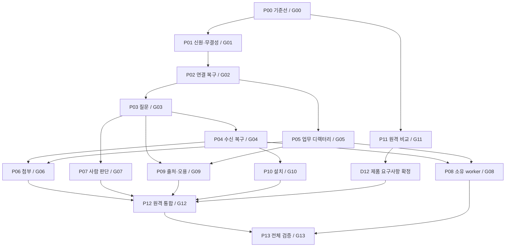

# 병렬 실행과 단계별 게이트

- 상태: 전체 구현 목표 유지, 사용자 요청으로 실행 일시정지. G00–G06·G08·G09·G10의 로컬 기술 계약 passed. G07 실제 UI와 G11–G13 원격·전체 여정은 미완이다. B05 고정본 회귀는 Python 두 버전 각각 1648개 OK다.
- 대상: [P00–P13 상세 작업](spec.md), [수용 조건 70개](acceptance.md), [기계 판독 계획](plan.json).
- 신규 ADR 9개와 기존 범위를 모두 유지한다. 아래 게이트는 구현 품질을 판정하는 지점이며 매 단계 사용자 승인을 요구하는 절차가 아니다.

## 확정 제품 목표

[ADR-0024](../../adr/0024-discover-select-and-handshake.md)와 [확정 설계](collaboration-contract.md)를 적용한다. 기존 ADR 9개·62개 조건을 유지하고 A24-01–08을 더해 총 70개다. B03은 로컬 발견/질문 계약, P12/P13은 맥북↔맥미니의 실제 발견→선택→핸드셰이크→협업을 담당한다. D04의 선택 단위와 D06의 후보 공개 경계는 사용자 결정이 확보됐다. 2026-10-28 승인에는 공개 API 철자·숫자 기본값·D12 선택이 포함되지 않았다. D12의 제품 요구사항은 2026-10-29 [ADR-0021](../../adr/0021-cross-machine-network-and-membership.md)로 별도 확정했다. 구현 goal은 일시정지 상태다.

2026-10-28 사용자가 실행 목표를 `B03까지 완주`로 재설정했고, 속도 회고 후 전체 계획 완수를 명령해 실행을 재개했다. 새 계약에 맞지 않는 기존 구현은 수정 대상으로 남기며 G02 통과로 소급 판정하지 않는다.

## 마감·개발 방침 (2026-10-28 21:15 개정)

[속도 회고와 개정 방침](development-policy.md)을 적용한다. 사용자가 목표를 전체 P00–P13 완수로 확장했다. 마감 목표는 2026-10-29 08:00 KST이며, B03은 최종 1305개 양쪽 회귀 통과로 종료했다. 아래 진행 규칙과 충돌하면 개정 방침을 따른다. 원래 단계·70개 조건은 유지한다.

## 1. 진행 방식

기준선→신원·무결성→연결 복구를 먼저 완성한다. 이후 질문 인터페이스와 업무 디렉터리를 병렬로 진행하고, 각 선행이 끝나는 즉시 복구·사람 판단·출처 보호 작업을 시작한다. 첨부·소유 worker·설치 개선도 필요한 선행만 기다린다. 원격 비교는 P00 뒤 별도 작업으로 시작해 로컬 구현과 겹친다.

계획상 동시 구현·조사 작업의 상한은 **3개**다. 코디네이터는 작업 배정·공유 파일 통합·게이트 판정을 맡는다. 독립 검토가 필요한 동안에는 구현 슬롯 하나를 검토에 배정해 가동 세션을 계속 늘리지 않는다. 이 수는 실행 자원에 대한 계획 가정이며 xsm의 `max_workers`·worker 풀·반복 제한 기본값을 변경하지 않는다. 실제 자원·구독 한도 확인 뒤 갱신한다.

선행 계약과 권한 경계가 안정된 독립 구현은 검토·회귀와 병렬로 진행할 수 있다. 게이트는 관련 통합 판정과 실제 검증 완료를 통제한다. 선행이 미통과인 소비자를 구현했다는 이유로 성공으로 세지 않으며, 알려진 차단 결함에 의존하는 실제 실행은 하지 않는다. 사용자 정책 선택·실행 승인의 경계는 별도로 유지한다.

그림은 대표 경로다. 생략된 전이 의존성까지 포함한 정확한 진입 조건은 아래 표와 plan.json의 `entry_gates`를 따른다. D12는 사용자 정책 결정이며 자체 P2P·선택적 Tailscale·Reason식 멤버십으로 확정됐다. 결정 확보는 G11 비교 완료나 G12 구현 통과를 의미하지 않는다.

## 2. 병렬 작업 배치

| 배치 | 착수 가능한 작업 | 병렬로 나누는 이유 | 통합 시 주의 |
|---|---|---|---|
| B00 | P00 | 기존 경로와 실패 표본을 먼저 고정 | 전체 회귀 결과·실환경/fixture 구분 없이 다음 품질 판정 금지 |
| B01 | P01 + P11 | 로컬 신원·무결성과 원격 비교의 시험 대상이 다름 | P11은 격리 비교체와 문서부터 진행. remote.py 제품 변경은 통합 담당에게 요청 |
| B02 | P02 + 진행 중 P11 | 실제 연결 실패 복구를 우선하며 원격 조사 지속 | 승인 수명·연결 범위는 D01/D04의 해당 변경분만 확인 |
| B03 | P03 + P05 + 진행 중 P11 | 질문 입출력과 디렉터리 추출은 고정된 CallContext를 사용 | cli.py·mcp.py 연결 코드는 공통 담당자가 한 번에 하나씩 반영 |
| B04 | P04 + P07 + P09 | 수신 회수, 사람 판단, 출처 표시의 독립 경로 | receive.py와 mcp.py 수정은 순서대로 통합. P09는 G05도 필요 |
| B05 | P06 + P08 + P10 | 자료 운반, 소유 worker journal, 설치 소유 기록은 독립 구현 가능 | files/worker/installer별 시험을 병렬 실행하고 paths.py·CLI/MCP 결합은 순서대로 반영 |
| B06 | P12 + 아직 진행 중인 독립 P08 검증 | 원격 통합은 로컬 계약과 백엔드 선택을 사용. P08은 P12의 필수 선행이 아님 | 공유 코드 revision을 확인하고 최대 3개 가동 슬롯 유지 |
| B07 | P13 | 실제 여정·혼합 버전·전체 조건을 한 통합 revision에서 판정 | 모든 70개 조건과 미검증 셀이 닫히기 전 완료 선언 금지 |

배치는 일괄 장벽이 아니다. P03이 먼저 끝나면 P05의 완료를 기다리지 않고 P04·P07을 시작할 수 있다. P06·P08은 G04와 G05가 모두 필요하다. P10은 G05·G07·G08을 기다리지 않는다. P12는 G08을 기다리지 않지만 P13은 기다린다.

진행 중 P11도 슬롯 하나를 사용한다. 따라서 P11이 끝나지 않은 동안 B04의 세 작업을 모두 새로 시작하면 상한을 넘는다. 이 경우 실제 선행을 가장 많이 푸는 작업과 이미 시작한 작업을 우선하고 나머지는 ready 상태로 대기한다. D12 제품 요구사항은 확보됐다. 미확보 환경의 비교 시험과 실제 실행 상태를 구분하며 대기만으로 worker를 유지하지 않는다. 구현 재개 뒤에는 남은 선행 게이트와 독립 로컬 작업을 기준으로 배치한다. 현재는 사용자 일시정지 상태다.

기간 실측 전에는 어느 경로가 가장 오래 걸리는지 단정하지 않는다. 일정에 영향을 주는 합류점은 G04+G05에서 열리는 첨부/worker, G06+G07+G09+G10+G11+D12에서 열리는 원격 통합, 전체 구현에서 열리는 G13이다.

## 3. 작업 소유권과 공유 파일 통합

### 역할

| 역할 | 책임 |
|---|---|
| 코디네이터·통합 담당 | 실제 시작 가능 작업 선택, 계약 revision 관리, 공유 파일 반영, 통합 revision 생성, 기술 게이트 판정 |
| 단위 구현자 | 배정된 P 단위의 기능·시험·실패 증거·복구 자료. 담당 외 권한과 정책을 임의 변경하지 않음 |
| 검증 담당 | 최종 반영된 revision의 경로 실행과 증거 검토. 구현자의 성공 주장만으로 판정하지 않음 |
| 독립 검토자 | P13에서 변경·확정 spec·수용 조건·실행 증거를 독립 검토. 실제 배정·시작·결과를 별도 기록 |
| 사용자 | 기존 승인으로 정해지지 않은 정책 선택과 실제 외부/권한/비용 경계의 결정 |

실제 작업을 시작할 때 역할에 세션을 배정한다. 계획의 역할 표를 worker가 이미 시작됐다는 근거로 사용하지 않는다. 병렬 실행 지시가 확정되면 사용 중인 하네스와 Orca 상태를 확인하고 해당 실행 절차를 따른다.

### 수정 경계

각 병렬 작업은 격리된 checkout/worktree와 자신에게 배정한 테스트 이름 공간을 사용한다. 통합 대상으로 제출하는 코드·계약·시험의 기준 revision을 고정한다. 아래 공유 파일은 코디네이터가 지정한 **한 명의 통합 담당**만 반영한다. 기능 구현자는 전용 모듈·전용 테스트를 구현하고 공유 파일에 필요한 연결 변경을 패치 제안으로 전달한다. 공통 기능이 실제 생기기 전에 모든 파일을 새 프레임워크로 추출하지 않는다.

| 공유 경계 | 주로 겹치는 단위 | 통합 순서와 책임 |
|---|---|---|
| mcp.py·cli.py·skill·도구 설명 | P03/P05, P07/P09, P06/P10 | 호출 문맥·질문 인터페이스 확정 후 각 기능을 한 번에 하나씩 연결. 입력 분배와 tool 목록은 통합 담당 소유 |
| receive.py·send.py·envelope.py·ledger.py·inbox.py·adapters.py·codex_daemon.py | P01/P03/P04 및 P06/P08/P09/P12의 연결 변경 | 먼저 원 ID·digest·인계 증거와 claim 계약 유지 여부를 대조. 중앙 경로에서 각 단위 테스트 재실행 |
| config.py·policy.py·connect.py·consent.py·outbox.py | P02/P05/P07/P09/P12 | 연결 범위·판단·실패 시 접근성 의미가 겹침. 변경된 정책 차이를 명시하고 같은 결정 레코드 사용 |
| registry.py·identity.py·resolve.py·probe.py | P01/P05/P10/P12 | 호출자 신원·업무 추출·진단이 같은 근거를 사용. 공유 탐색 예산과 원격 핸들 유지 |
| paths.py·housekeeping.py·doc.py·channel.py | P06/P07/P10 및 journal 연결 변경 | 저장 mode·정리 범위·사본/정본·결정 권위가 달라지지 않는지 확인 |
| workers.py·attempts.py | P07/P08/P09 | P07의 승인 경로 변경과 P08의 실행 수명 변경은 같은 파일의 통합 소유자를 인계해 반영 |
| install.py·hooks·plugin manifests·README | P10 및 P12 어댑터 등록 | 소유 항목·지원 능력·실제 설정 차이를 한 manifest에 반영 |
| remote.py | P04/P06/P11/P12 | P11은 비교와 읽기부터 진행. 기존 SSH 조정·첨부 협상·선택 백엔드의 제품 반영은 통합 담당이 순서대로 수행 |
| tests/test_xsm.py·tests/test_version_mix.py 등 공통 회귀 | 여러 단위 | 공통 fixture 수정은 검증 담당이 반영. 기능별 반례와 원인 검사를 상호 덮어쓰지 않음 |

통합 순서는 **수신한 패치의 선행·계약 확인 → 공유 파일 반영 → 해당 단위의 경로 검사 → 영향받는 공통 회귀 → 통합 revision 기록**이다. 텍스트 충돌이 없다는 이유로 의미 충돌이 없다고 판정하지 않는다. 계약이 바뀌면 소비자가 새 revision에 맞춘 뒤 다시 검사한다.

## 4. 공통 경계의 고정과 재개방

| 경계 ID | 고정할 의미 | 처음 통합하는 게이트 | 소비 작업 |
|---|---|---|---|
| IC01 | CallContext의 home·대화·세대·식별 근거·파일 권한과의 관계 | G01 | P02–P10, P12 |
| IC02 | 원 요청 ID·전체 digest·legacy status와 evidence의 관계 | G01 | P02–P04, P06–P10, P12 |
| IC03 | 연결 의도·사람 판단·적용 결과의 결속 | G02 | P03/P05/P06/P07/P09/P10/P12 |
| IC04 | reply_to·부분/최종 회신·대기 종료·claim/ack·회수 | G03에서 질문 계약, G04에서 회수 계약 보완 | P06/P07/P08/P10/P12 |
| IC05 | 첨부 manifest·공유 권한·사본 수명·기능 협상 | G06 | P09/P10의 후속 통합, P12 |
| IC06 | 원격 origin·send/status/capabilities·가입 readback·경로 증거 | G11에서 비교 기준, D12 뒤 G12에서 제품 계약 | P12/P13 |

고정은 변경 금지가 아니라 소비할 기준 revision을 정하는 일이다. 바꾸려는 의미·원인·영향받는 소비 작업·이행 검사만 제시하고 통합 담당이 반영한다. routine 코드 수정마다 사용자의 승인을 새로 받지 않는다. 범위·보존·권한 같은 미결 정책을 바꾸는 경우에만 해당 D 결정을 확인한다.

## 5. 단계별 기술 게이트 G00–G13

각 P 단위의 출구가 같은 번호의 G 게이트다. 진입 게이트가 모두 현재 통합 revision과 호환되어야 제품 구현을 시작한다. 아래는 **계획된** 조건이다. 현재 게이트 상태: **G00 `passed`**([기록](gates/G00-baseline.md)), **G01 `passed`**([기록](gates/G01-identity-integrity.md); 1차 failed → 수정 → 3차 검토 통과), G02 `passed`([기록](gates/G02-connection-intent.md)), G03/G05 `passed`, 나머지 G04/G06–G13 준비/미평가.

| 게이트 | 필수 진입 | 반드시 실행해 확인할 종료 조건 | 판정 책임 |
|---|---|---|---|
| G00 기준선 | 없음 | 전체 기존 회귀 결과, 기준 버전/홈/하네스 manifest, S5 비동기 입력 채널 관측, crash 제어 시험체 확보. 재현 못 한 항목은 실패/미확정으로 표시하고 기준선 준비와 결함 해결을 구분 | 코디네이터 + 검증 담당 |
| G01 신원·무결성 | G00 | A/B 호출별 신원·홈과 원 ID/digest 일치. 200자 동일 다른 본문·다른 대상 재전송 거절. queue 실패·소켓 write만 된 경우 런타임 도달 성공 아님. 구 reader가 기존 송신을 유지 | 구현자 증거를 검증 담당이 대조, 코디네이터 판정 |
| G02 연결 복구 | G01 | 같은 비동기 답 채널의 원문→유효 판단→연결 readback→같은 원 ID 전송→실제 회신. 수집 단절은 unknown. 거부/취소는 미연결. 적용 후 crash 재개에 같은 허용 재질문 없음. 형제·다른 부모 직접 왕복 | 연결 구현자 + 실제 하네스 검증 담당 |
| G03 질문 인터페이스 | G01, G02 | CLI/MCP가 원 요청의 실제 답을 반환. 핸드셰이크는 선택 상대의 실제 응답으로 완료. 영수증만 있으면 답 미완. 동시 reply·timeout·cancel·양식 대기 중 다른 tool/ping이 유실되지 않음. sandbox 첫 답장 경로와 미독 회수 유지 | 인터페이스 구현자 + 검증 담당 |
| G04 수신 복구 | G03 | claim/반환/ack 전후 종료와 대기 취소 뒤 회수. 확인된 메시지 중복 억제. 일반 Codex 다중 홈 실제 수신/회신. FYI의 무기상과 다음 자연 소비를 각각 확인. 이전 상태/시간 역행/unknown readback 대조 | 상태 구현자 + 실제 하네스 검증 담당 |
| G05 디렉터리 | G01, G02 | 명시 공개 또는 같은 repository 후보를 머신·업무·branch로 고르고 실제 핸들과 일치. 후보 표시만으로 새 협업 권한을 열지 않음. resume/new/rename/pid 재사용 구분. 추출 실패 시 기본 통신 유지. 공유 예산·제외 경로 일관성의 로컬 경로 확인 | 디렉터리 구현자 + 검증 담당 |
| G06 첨부 | G03, G04, G05 | CLI/MCP 본문·수신 사본 digest 일치. 공유 MCP 폴더 격리. 허용된 외부/숨김 자료 성공과 권한 밖 자료 거절. 구버전·quota·disk full·재시작·원본 보존 확인 | 첨부 구현자 + 파일 권한 실환경 검증 담당 |
| G07 사람 판단 | G02, G03 | 실제 표시 원문/잘림과 기록 일치. 중복 질문 한 창·한 적용. 늦은 답·철회·세대 교체 대조. 거부/미표시/취소 구분 가능한 범위 기록. OS 지연·실패에 접수와 실제 호출 결과를 구분 | 판단 구현자 + UI 검증 담당 |
| G08 소유 worker | G03, G04, G05 | 일반/owned 경로별 MCP·회신·후속 기억·권한 확인. 문맥 격리·직렬/병렬·용량+1. 저장 경계 crash 뒤 답 재송신에 모델 재실행 없음. 부작용 중복 경계 표시 | worker 구현자 + 구독 런타임 검증 담당 |
| G09 출처·오용 | G03, G05 | 가짜 프레임·승인·ANSI/bidi가 출처를 바꾸지 않음. 정상 다회 N:N과 반복 폭주 대조. native 통과·strict/deny·unchecked 기존 정책 회귀 없음. 정책 오류의 새 권한 확대·원문 유실 없음 | 출처 구현자 + 검증 담당 |
| G10 설치 | G01, G02, G04 | clean/기존·단일/다중/비기본 홈·기존/새 세션의 실제 첫 왕복. 사용자 설정/mode·소유 항목 보존. 구 MCP/훅 실행 중 update 실패·롤백. 능력 진단과 관측 일치, 민감 로그·사용자 세션 종료 없음 | 설치 구현자 + 실제 설치 검증 담당 |
| G11 원격 비교 | G00 | A/B/C/D 동일 과제의 설치·사용자 개입·첫 왕복·경로·운영/제거 근거. 물리 환경별 지원 불가·실패·미실행 구분. 사용자 선택용 비교 결과가 준비됨. D12의 선택 자체는 통과 근거에 포함하지 않음 | 원격 조사 담당 + 검증 담당 |
| G12 원격 통합 | G04, G05, G06, G07, G09, G10, G11 및 D12 선택 | 두 물리 머신의 발견→사용자 선택→핸드셰이크→협업 및 NAT/proxy/relay/SSH 조건의 질문·첨부·후속·직접 reply·복구. 인증된 origin·팀/업무 권한 분리. 초대/제명/전환 실패. 실제 bind/fallback. 원격 중단 중 로컬 왕복과 소유 서비스 중지 확인 | 원격 구현자 + 물리 환경 검증 담당 |
| G13 전체 완료 | G02–G10, G12 | 같은 통합 revision에서 J01–J09·K01–K11·70개 조건과 세부 실환경 셀 판정, 20개 잔여 항목의 실제 처리, 구버전 이행·되돌리기·독립 검토·문서 일치. 실패/미실행이 있으면 전체 미완 | 코디네이터 + 검증 담당 + 독립 검토자 |

기존 baseline 실패가 있으면 원문과 영향을 기록한다. baseline을 수집했다는 G00 판정이 baseline 제품의 모든 기능 성공을 의미하지 않는다. S5의 실제 실패 경로를 재현하거나 충분히 관측하지 못하면 G02의 해당 조건은 통과할 수 없다. 환경 미확보는 기술 성공도 사용자 생략 승인도 아니다.

G01·G03·G05·G06·G09·G10의 종료는 그 시점에 구현된 경로의 검증이다. 원격 동명·첨부·새 backend처럼 뒤에서 생기는 세부 항목은 `partial`이다. 각 수용 조건의 `closure_gates`가 모두 통과한 뒤에도 해당 조건의 실행 증거를 대조해야 하며, 게이트의 통과만으로 70개 조건을 자동 통과시키지 않는다.

## 6. 사용자 정책 결정은 관련 변경만 막는다

| 기술 게이트/작업 | 확인할 결정 | 적용 조건 |
|---|---|---|
| G01/P01 | D03 | 새 영구 형식·원문 보존·구기록 재전송 의미를 확정하기 전. 기존 기록 조사·새 digest 반례 준비는 계속 가능 |
| G02/P02 | D01, D04 | 새 승인 출처/적용 의미 또는 기본 연결 단위·수명을 바꾸는 부분. 기존 범위 안 복구는 기존 결정 재사용 |
| G03/P03 | D02 | 공개 질문 계약·기본 대기/최종성 확정. 명시 입력을 쓰는 격리 시험은 계속 가능 |
| G04/P04 | D05 | 자동 회수·만료·보존 기본값 활성화. fixture의 명시 값으로 경계 시험 가능 |
| G05/P05 | D04, D06 | 대화/미독 상속·doing/경로 공개 의미 변경. 기존 주소·비공개 시험 표본 검증 가능 |
| G06/P06 | D05, D07 | 실제 파일 송신 권한 방법·quota·본문 대체·cleanup 활성화 |
| G07/P07 | D01, D08 | 늦은 답의 적용 권한·새 UI/알림·표시/보존 기본값 변경 |
| G08/P08 | D09 | 문맥 공유·자동 재사용·풀/퇴출 정책 활성화 |
| G09/P09 | D10 | 새 반복/다중 대상 제약 활성화. 출처 rendering과 관측 전용 시험은 계속 가능 |
| G10/P10 | D11 | 지원 행렬·자동 교체·백업 보존 약속 확정. 기존 지원 경로의 소유 항목 검사는 계속 가능 |
| P12 착수/G12 | D12 | 요구사항 결정 확보: ADR-0021 참조. 구현 라이브러리·버전·relay 주소 등은 후속 명세로 정하며 backend 재선택을 묻지 않는다. G07/G11 미완과 구현 일시정지는 유지 |

결정은 `기존 결정 재사용`, `해당 변경에 대한 사용자 결정 확보`, `변경을 활성화하지 않은 부분 구현`, `미결`로 기록한다. 유효한 기존 승인이 있으면 다시 받지 않는다. 답이 없다는 이유로 새 정책을 확정하지 않는다. 미결 정책의 영향을 받는 부분은 완료로 세지 않으며 독립 작업까지 멈추지 않는다.

push·게시·배포·권한 규칙·자격 증명·유료 자원 등 실제 실행 승인은 기술 게이트와 다르다. 예를 들어 G13이 통과해도 배포 승인으로 사용하지 않는다. 반대로 이미 허용된 로컬 수정과 기술 게이트 통과에 새 사용자 확인을 추가하지 않는다.

## 7. 게이트 증거와 상태

기술 게이트는 다음 자료를 같은 revision에 결속한다. 아직 runner가 없는 미래 검사를 실행한 것처럼 기록하지 않는다.

게이트별 실행 기록은 `gates/G00-baseline.md`처럼 `gates/` 아래에 남긴다.

**검토 정책 (2026-10-28 21:15 재개정):** 주요 게이트의 Opus 5.5 검토는 유지하되 통합 묶음당 독립 전체 검토는 1회로 한다. G03·G05는 이미 받은 통합 검토를 재사용한다. 자동 2축 검토·전체 재검토 반복은 없앤다. 지적은 재현·수정·영향 검사로 코디네이터가 닫고, 필요하면 미해소한 해당 지적만 추가 확인한다. 코드/지침 동결 후 전체 회귀는 두 인터프리터로 병렬 1회씩 수행한다. 실질 변경·실패 없이 이미 통과한 실험을 반복하지 않는다. 이미 계획된 필수 검증은 생략하지 않는다. 상세 실행 순서와 60–90분 종료 기준은 [개정 방침](development-policy.md)을 따른다.

| 자료 | 기록할 내용 |
|---|---|
| 입력 식별 | 작업/시도 ID, source·spec·공통 계약 revision/hash, 부모 통합 revision, 실행자 역할과 실제 세션/도구 실행 근거 |
| 변경 범위 | 수정 파일, 공유 파일 통합 담당, 계약 차이와 소비 작업, 사용자 정책/실행 승인의 해당 근거 |
| 실행 | 실제 명령·환경 alias·기대/실제 exit code·시각·원시 로그 경로/hash, fixture/실제 하네스/UI/물리 환경 구분 |
| 반례 | 고치려는 결함이 수정 전 실패했고 수정 뒤 같은 경로에서 통과한 근거. 필요한 새 검사는 임시 복사본의 결함 변이도 검출 |
| 통합 | 최종 반영 revision의 해당 단위 경로·영향 회귀. 구현자 worktree에서만 통과한 결과와 구분 |
| 판정 | passed/failed/unknown/partial, 조건별 통과/미실행, 남은 소유자·재개 조건, 판정자와 검토 근거 |

실행 중 상태는 `planned → ready → running → verifying → passed`로 관리한다. 실패는 `failed`, 외부 결과나 증거 부족은 `unknown/partial`로 기록하고 필요한 수정·관측 후 재평가한다. user 선택 대기는 별도 이유와 영향을 기록한다. 실제 시작·종료를 관측하지 못한 worker를 running/finished로 꾸미지 않는다.

검증 담당은 해당 명령의 실제 결과와 실행 경로를 확인한다. 이미 같은 통합 revision에서 통과한 검사를 이유 없이 반복하지 않는다. 새 변경·실패·미해결 우려가 있을 때 영향 검사만 다시 실행하며, G13에서는 통합된 전체 여정을 실행한다.

## 8. 실패와 재검증의 범위

1. G 게이트가 실패하면 그 게이트를 필요로 하는 후속 작업의 통과 판정을 중단한다. 독립 작업과 이미 허용된 읽기/준비는 계속한다. 예를 들어 G04 실패는 P06/P08/P10/P12를 막지만 P05/P07/P09/P11의 독립 경로를 일괄 중단시키지 않는다.
2. 공통 계약 변경은 step 의존성 외에 IC 소비 목록과 수용 조건의 `closure_gates`를 함께 대조한다. 예를 들어 G06의 manifest 변경은 이미 구현한 P09/P10의 연결 부분도 재검증한다.
3. 무관한 설명 수정으로 모든 게이트를 무효화하지 않는다. 코드 경로·wire/state 의미·정책·필요 실행 환경이 바뀐 범위와 그 소비자만 다시 검사한다.
4. unknown 변경 요청은 대상 상태를 readback하기 전 재송신하지 않는다. 같은 semantic request ID를 유지한다. 모델의 성공 요약으로 외부 상태를 확정하지 않는다.
5. 실패 자료와 이미 모은 부분 증거를 보존하고, 실패를 회피하려고 범위·환경·수용 조건을 줄이지 않는다. 실제 재현을 fixture 성공으로 대체하지 않는다.
6. 최종 통과에는 게이트·조건별 실행 결과·정책 결정을 모두 대조한다. `done` 메시지, 합쳐진 파일 수, 테스트 총합만으로 통과하지 않는다.

## 9. 이 계획 보강의 검증

계획 검사에서는 P00–P13과 G00–G13의 1:1 대응, 모든 선행의 진입 게이트 매핑, 병렬 배치의 DAG 타당성, 최대 가동 슬롯, 공유 파일 통합 규칙, 70개 조건의 종결 게이트, 기존 43개 발견·20개 미검증의 유지 여부를 확인한다. 일부러 선행 게이트를 지우거나 병렬 배치에 역순 작업을 넣었을 때 검사가 잡는지도 확인한다. [검사 결과](validation.json)에 문서와 기계 판독 계획의 hash 및 검사 범위를 남긴다.

이 검사는 계획의 일관성 검사다. 실제 worker 실행·제품 구현·단계별 기술 통과·사용자 정책 결정이 이루어졌다는 뜻이 아니다.
